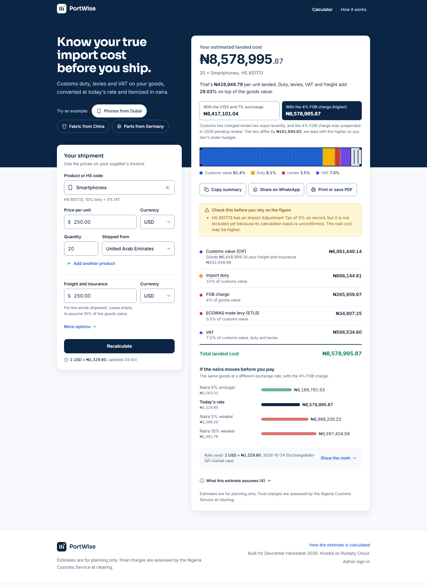
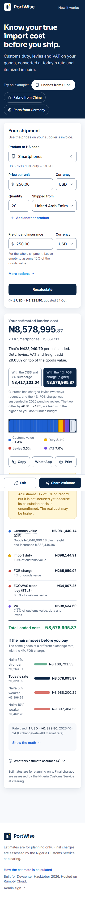
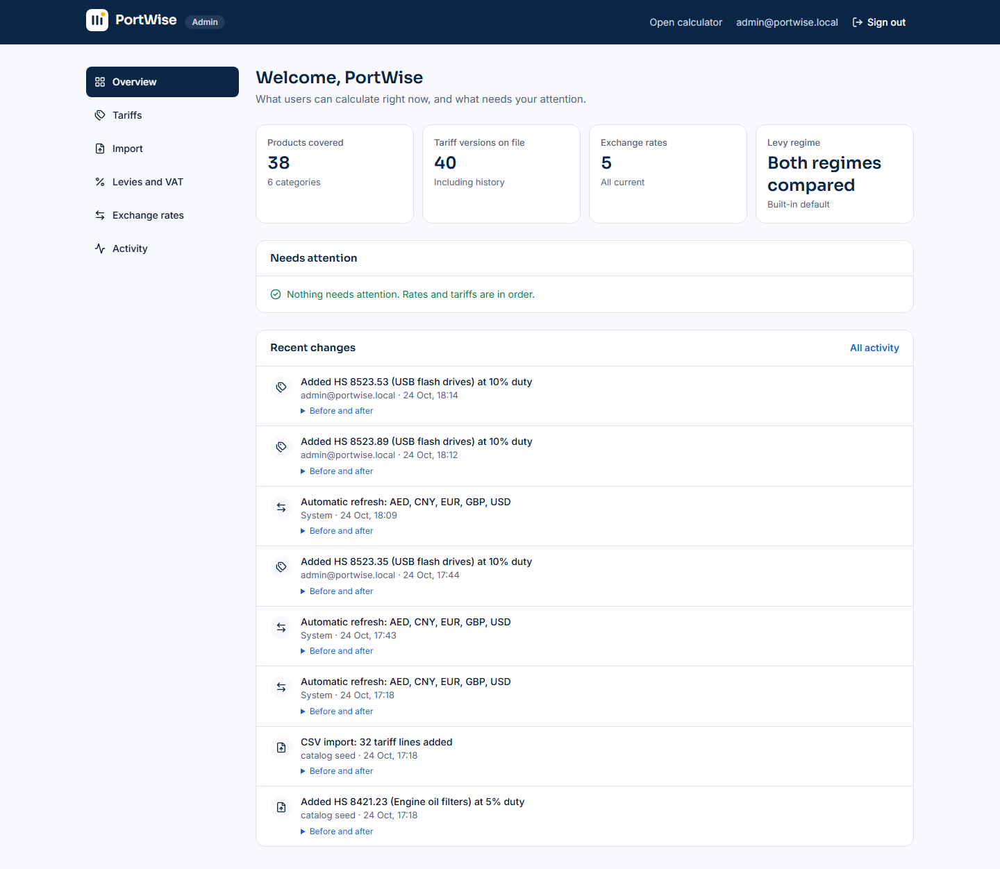
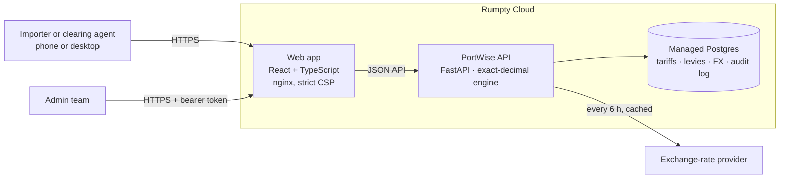

<div align="center">

# PortWise

### Know your true import cost before you ship.

PortWise turns a supplier's invoice into an itemized **landed cost in naira** (customs duty, levies, VAT and today's exchange rate) in under a minute, and shows every rate behind the number.

**Built for Devcenter Hacktober 2026 · Hosted on Rumpty Cloud**

**[Try PortWise](https://portwise-web.rumptycloud.app)** · [Live API](https://portwise-api.rumptycloud.app) · [API docs](https://portwise-api.rumptycloud.app/docs) · [How it's built](#architecture) · [Run it locally](#run-it-locally)



</div>

---

## The problem

A phone reseller in Lagos orders 20 handsets at $250 each and budgets for the goods. At the port, the bill grows by customs duty, a surcharge, two or three levies, VAT and whatever the naira did since the order. That is often more than **a quarter on top**, discovered after the deposit is paid.

The rules exist, but they are spread across tariff PDFs, fiscal-policy circulars and rates that change. Small importers and the clearing agents who quote for them have no quick, trustworthy way to get the number first.

## What PortWise does

1. **Pick the product.** Search by name or HS code: "phone", "ankara", "8517".
2. **Enter the invoice.** Price, currency, quantity, origin country, and freight if you know it.
3. **Get the landed cost.** One total in naira, then exactly what it is made of.

## Why it stands out

| | |
| --- | --- |
| **Every naira is explained** | The breakdown lists every charge, the rate applied and the amount it was applied to. "Show the math" walks through each step with the real numbers. |
| **Honest about uncertainty** | Customs has charged levies two ways recently, and the 4% FOB charge was suspended in 2025 pending review. PortWise computes **both**, leads with the higher figure, and says why. Warnings and assumptions, such as assumed freight, Import Adjustment Tax on record or an old exchange rate, are shown in plain words. |
| **The naira moves; so does the estimate** | A sensitivity table shows the landed cost if the naira is 5% stronger, or 5% or 10% weaker, before you pay. |
| **Sourced tariff data** | 32 product lines. Each duty rate is read at the 10-digit line from the ECOWAS CET 2022–2027 schedule, checked against Nigeria's 2026 Fiscal Policy Measures, and stored with its source reference. |
| **Live exchange rates** | Refreshed from a market-rate provider every few hours. The rate, its source and its date sit next to every total. |
| **Built for how importers work** | Mobile-first. Share on WhatsApp, a printable quote for clearing agents, and a link that reopens the exact estimate. No accounts, and nothing personal is stored. |
| **An admin team can keep it right** | A dashboard to add products, change a rate from a date (history is kept), import CSVs, tune levies and VAT, refresh FX, and see every change in an audit log. A change appears in the calculator within seconds, with no redeploy. |

<p align="center">
  
  &nbsp;
  
</p>

## Try it in three minutes (demo script)

| Time | Do this | What it shows |
| --- | --- | --- |
| 0:00 | Open the app and click **Phones from Dubai** | A one-click estimate. The server wakes and calculates in seconds. |
| 0:30 | Read the docket top to bottom | The total first, then the per-unit cost, the two levy regimes, the charge breakdown and the warnings |
| 1:00 | Click **Show the math** | Each step: goods × rate, + freight, × duty, levies, VAT |
| 1:20 | Change the price or currency | The total updates as you type |
| 1:40 | **Share on WhatsApp** | A ready summary, plus a link that restores this exact estimate |
| 2:00 | Sign in at `/admin` → **Tariffs** → **Add HS code** | Add a product with its duty rate and source |
| 2:30 | Back in the calculator, search for it | It is there, with no redeploy |
| 2:50 | Admin → **Activity** | Who changed what, with before and after |

## How the number is worked out

```text
Goods value (FOB)   = price × quantity × exchange rate
Customs value (CIF) = FOB + freight and insurance        (assumed 10% of FOB if not entered, and stated)
Import duty         = CIF × duty rate for the HS code
IAT                 = CIF × IAT rate, for the codes that carry it (e.g. 5% on smartphones)
Levies              = 7% surcharge on duty
                      + legacy: 1% CISS on FOB, or fob4: 4% FOB charge (in place of CISS)
                      + ETLS 0.5% of CIF
VAT                 = 7.5% × (CIF + duty + levies)                 (IAT is not in the VAT base)
Landed cost         = CIF + duty + IAT + levies + VAT
```

Every charge is computed in exact decimals and rounded half-up to the kobo. VAT and the totals are built from the rounded lines, so the numbers always add up. A multi-product shipment shares freight by goods value. Vehicles, alcohol and tobacco, which have extra duty rules, are refused rather than estimated wrongly.

**Reference check** (the same in every test suite): ₦3,000,000 FOB plus ₦450,000 freight at 20% duty gives **₦4,553,216.25** (legacy) and **₦4,649,966.25** (4% FOB charge, which keeps the surcharge).

## Architecture



| Layer | Stack |
| --- | --- |
| Web app | React 19, TypeScript (strict), Vite, Tailwind CSS v4, TanStack Query, React Hook Form + Zod. Served by unprivileged nginx with a strict CSP. |
| API | Python 3.11, FastAPI, Pydantic, SQLAlchemy 2, exact `Decimal` arithmetic |
| Data | Postgres on Rumpty (SQLite locally), self-upgrading schema, effective-dated tariffs |
| Ops | Docker images for both services, Rumpty App Deployments and Monitoring (`/health`) |

The web app holds **no money logic**. It formats what the API returns, and a captured real API response is a contract test, so the two cannot drift apart silently.

## Data and accuracy

- **Duty rates:** `portwise-backend/data/tariffs_2026.csv` holds 32 HS lines in six categories: phones and electronics, textiles, cosmetics, machine parts, footwear and vehicle parts. Each rate is read at the 10-digit line from the ECOWAS CET 2022–2027 schedule and checked against the 2026 Fiscal Policy Measures (circular F17417/III/374; gazette S.I. 29 of 2026) for Import Adjustment Tax and the prohibition list. `tariffs_2026_sources.csv` keeps the notes and URLs.
- **Two rows to confirm on the NCS portal**, which blocks automated access:
  - the 5% IAT on smartphones, which is gazetted against the older code 8517.11
  - the wax-print line 5208.52.10, which is 20% while similar lines are 35%
- **Exchange rates:** market rates from ExchangeRate-API, refreshed every 6 hours and flagged when older than 3 business days.
- **Import Adjustment Tax** is flagged in warnings but not added yet, because its calculation basis is unconfirmed.
- **PortWise gives estimates.** Final charges are assessed by the Nigeria Customs Service at clearing.

## Security

A full adversarial review was run before submission, and every finding is fixed and covered by tests (`portwise-backend/tests/test_security.py`).

- **Admin access:**
  - Passwords are hashed with PBKDF2-SHA256.
  - Sessions use HMAC-signed bearer tokens that expire after 12 hours and end when the password changes.
  - No default account exists in production. A local dev account requires `PORTWISE_DEV=1` and is removed at start-up otherwise.
  - The signing secret is never derived from other settings.
- **Brute force and abuse:**
  - Failed sign-ins are limited per account and per client IP, using the proxy-appended hop, not a client-supplied header.
  - The public calculator is rate-limited (60 per minute per client).
  - Request bodies are capped (64 KB public, 2.2 MB for admin imports), shipments to 50 lines and CSV imports to 5,000 rows.
- **Input and output:** all input is validated with Pydantic and Zod. All SQL goes through the ORM. API text renders as escaped React text, never raw HTML. Provider errors never echo the FX API key.
- **Web:** strict Content-Security-Policy, `frame-ancestors 'none'` and X-Frame-Options, `nosniff`, Referrer-Policy, Permissions-Policy and HSTS on every response. `scripts/csp-check.mjs` proves the app runs under the policy.
- **Supply chain and containers:**
  - Version-bounded Python dependencies and a locked npm tree; `npm audit` and `pip-audit` both report 0 known vulnerabilities.
  - Both containers run as non-root.
  - No build tools ship in the API image, and no secrets are in the repo or its history.
- **Data protection:** no personal data is collected. Every admin change is audited with before and after values.

## Quality

| Check | Result |
| --- | --- |
| API tests (`pytest`): engine, rules, catalog, admin, migrations, security | **102 passing** |
| Web unit tests (`vitest`): engine mirror, parsing, URL state, form rules, API contract | **32 passing** |
| Browser tests (`playwright`), desktop and mobile | **10 passing** |
| Admin walkthrough: sign in, add a product, see it in the calculator | `scripts/admin-walkthrough.mjs` |
| Production CSP check | No violations |
| Dependency audits (`npm audit`, `pip-audit`) | 0 vulnerabilities |
| Accessibility | Keyboard-operable throughout, an ARIA 1.2 combobox, real tables, focus moved to results, reduced motion respected, WCAG AA contrast |
| Performance | 147 KB gzipped initial JS; the admin dashboard is a separate 13 KB chunk |

## Run it locally

**Prerequisites:** Python 3.11+ and Node 20+.

```bash
# 1. API: http://localhost:8000 (docs at /docs)
cd portwise-backend
python -m venv .venv
.venv/Scripts/activate              # macOS/Linux: source .venv/bin/activate
pip install -r requirements-dev.txt
PORTWISE_DEV=1 uvicorn app.main:app --reload --port 8000
#   Windows PowerShell: $env:PORTWISE_DEV="1"; uvicorn app.main:app --reload --port 8000

# 2. Web app: http://localhost:5173
cd portwise-frontend
npm install
cp .env.example .env                # set VITE_API_URL=http://localhost:8000
npm run dev
```

On SQLite (the default), start-up creates the tables, loads the sample rows and the 2026 catalog, and fetches live exchange rates. With `PORTWISE_DEV=1` it also creates a local admin you can sign in with at `/admin`. Its address and password are `DEV_ADMIN_EMAIL` / `DEV_ADMIN_PASSWORD` in `app/admin/auth.py`; never enable dev mode on a public server.

No backend handy? `http://localhost:5173/?demo=1` runs the web app on a built-in mock that mirrors the engine to the kobo. It is clearly labelled "Sample data".

### Tests

```bash
cd portwise-backend  && pytest
cd portwise-frontend && npm test          # unit
cd portwise-frontend && npm run e2e       # browser, desktop and mobile
```

## Deploy on Rumpty Cloud

**API** (`portwise-backend/Dockerfile`)

| Variable | Required | Purpose |
| --- | --- | --- |
| `DATABASE_URL` | yes | Managed Postgres connection |
| `ADMIN_EMAIL`, `ADMIN_PASSWORD` | yes | The admin account. The password must be at least 12 characters. |
| `ADMIN_TOKEN_SECRET` | yes | A long random value that signs admin sessions |
| `CORS_ORIGINS` | recommended | The web app's URL (default `*`) |
| `FX_API_KEY` | optional | ExchangeRate-API v6 key. Without it, the free open endpoint is used. |
| `RATE_LIMIT_PER_MINUTE` | optional | Calculations per client per minute (default 60) |

On start-up the API upgrades the schema in place and refreshes exchange rates. To load the tariff catalog on a fresh database, sign in at `/admin` → **Import** → **Preview the catalog** → **Import**, or run `python -m scripts.load_catalog`.

**Web app** (`portwise-frontend/Dockerfile`, port 8080; Rumpty's `$PORT` overrides it)

| Build argument | Value |
| --- | --- |
| `VITE_API_URL` | `https://portwise-api.rumptycloud.app` (also used for the CSP) |
| `VITE_SITE_URL` | `https://portwise-web.rumptycloud.app` (the web app's own URL, for link previews) |

## API at a glance

| Method | Path | Purpose |
| --- | --- | --- |
| POST | `/api/v1/calculate/multi` | A shipment of 1–50 products. The web app uses this. |
| POST | `/api/v1/calculate` | A single item |
| GET | `/api/v1/hs-codes` | Products with a tariff in force, by category |
| GET | `/api/v1/fx` | Exchange rates with source, age and flags |
| GET | `/api/v1/presets` | Demo scenarios |
| GET | `/api/v1/config/regime` | Active levy regime and rates |
| GET | `/`, `/health` | Liveness check (no database access) |

Business-rule errors return HTTP 400 with `{success: false, code, detail}`. The codes are `prohibited_item`, `unsupported_goods`, `unknown_hs_code`, `no_tariff_in_force` and `unsupported_currency`. Invalid input returns 422, an oversized body 413, and rate limiting 429. Full reference: [`/docs`](https://portwise-api.rumptycloud.app/docs).

## Repository

```text
portwise-backend/    FastAPI app (app/), tests/, data/ (tariff catalog), scripts/
portwise-frontend/   React app (src/), e2e/, scripts/ (screenshots, CSP check, admin walkthrough)
docs/                Screenshots used in this README
```

## The team

Four developers, one API contract agreed on day one:

| Role | Owned |
| --- | --- |
| Backend | Calculation engine, levy regimes, rules, API |
| Full-stack | Postgres, FX ingestion, Rumpty deployment and monitoring |
| Frontend | Calculator, design system, accessibility, admin dashboard, pitch |
| PHP | Admin and tariff data operations |

## What's next

- Full HS coverage loaded by CSV, and freight estimates by route
- Saved and branded quotes for clearing agents (a paid tier)
- Import Adjustment Tax, once its basis is confirmed
- Pidgin, Yoruba, Hausa and Igbo

---

<sub>Estimates are for planning only. Final charges are assessed by the Nigeria Customs Service at clearing.</sub>
