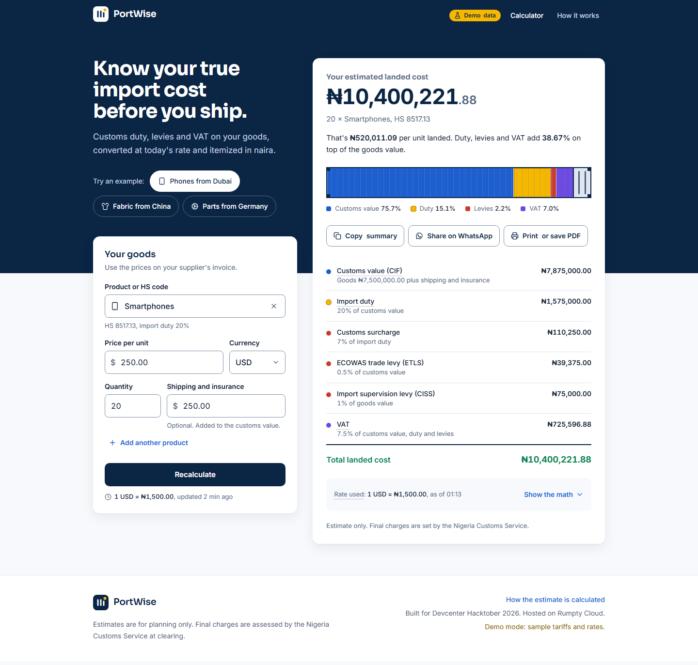

# PortWise frontend

The calculator that importers use: pick a product, enter the invoice price, and get an itemized landed cost in naira (customs value, duty, each levy, VAT and the exchange rate used), with a shareable link and printable quote.

Built from the team's *Frontend Source of Truth* and the API contract in the *Backend and Database Document*.



## Stack

Vite, React 19, TypeScript (strict), Tailwind CSS v4, TanStack Query, React Hook Form with Zod, React Router, lucide-react icons, and MSW for the mock API. Tests use Vitest and Playwright.

## Run it

```bash
cd portwise-frontend
npm install
cp .env.example .env      # mocks are on by default
npm run dev               # http://localhost:5173
```

| Command | What it does |
| --- | --- |
| `npm run dev` | Dev server |
| `npm run build` | Type-check and build to `dist/` |
| `npm test` | Unit tests (formula, parsing, URL state, form rules, contract) |
| `npm run e2e` | Playwright end-to-end tests on desktop and mobile, against a production build in demo mode |
| `npm run lint` | ESLint, including jsx-a11y |
| `node scripts/screenshots.mjs` | Screenshots of every state at 1440 px and 360 px, plus a console-error check (needs `npm run dev`) |
| `node scripts/make-assets.mjs` | Regenerates the PNG icons and the Open Graph image in `public/` |

## Environment variables

Vite inlines these at build time, so changing them requires a rebuild.

| Variable | Example | Purpose |
| --- | --- | --- |
| `VITE_API_URL` | `https://api.portwise.example/api/v1` | Main API base URL, including `/api/v1` |
| `VITE_USE_MOCKS` | `false` | `true` serves every API call from the in-browser mock and shows a **Demo data** badge |
| `VITE_SITE_URL` | `https://portwise.example` | Absolute site URL, used for the share-preview image |

## Demo mode and the real API

Until the Main API is live, the app runs on a mock API (MSW) that implements the formula in the Backend document. The mock reproduces both worked examples: ₦10,400,221.88 for the smartphones and ₦3,618,450.00 for the fabric (see `src/mocks/engine.test.ts`). Its tariff data is sample data, and whenever it is active the header shows **Demo data**.

- Switch to the real API: set `VITE_USE_MOCKS=false` and `VITE_API_URL`, then rebuild.
- Emergency fallback on demo day: add `?demo=1` to any URL (`?demo=0` turns it off).
- Rehearse failures: with demo mode on, `?mockfail=FX_UNAVAILABLE`, `INTERNAL_ERROR`, `NETWORK` or `SLOW` (`?mockfail=off` resets).

## API contract the frontend expects

The full contract is `src/lib/api/schemas.ts`, matching §3 of the Backend document. Responses are validated there once, and a mismatch shows a friendly error instead of breaking the page.

| Endpoint | Shape used |
| --- | --- |
| `POST /calculate` | Request `{ items: [{ hs_code_id, unit_value, currency, quantity, shipping_insurance, weight_kg }] }`. Response `{ currency, fx[], items[], totals, disclaimer }` exactly as in the Backend document. Optional extras the UI uses when present: levy `name` and `base`; duty `rate_type` and `rate_per_kg`; item `currency`, `unit_value` and `weight_kg`. |
| `GET /categories` | `[{ id, slug, name, needs_weight, icon? }]` (a bare array or `{ data: [...] }`) |
| `GET /hs-codes?limit=500` | `[{ id, code, description, category_id, keywords?, rate_type?, duty_pct?, rate_per_kg?, needs_weight?, has_rate? }]` |
| `GET /fx?from=USD` | `{ from, rate, fetched_at, stale }` |
| `GET /presets` | `[{ id, label, description?, items: [request items] }]` |
| Errors | `{ error: { code, message, fields } }`. Field keys look like `items.0.unit_value`, so messages land on the right input. A `X-Request-ID` header is shown as a reference. |

The backend also needs:
- CORS allowing this site's origin.
- Money as JSON numbers or decimal strings; both are accepted.

## Project layout

```
src/
  lib/            api client, schemas (contract), hooks, formatting, parsing, URL state
  features/
    calculator/   page, form, product combobox, presets, form model, error copy
    results/      docket, container bar, show-the-math, share, FX badge
    methodology/  "How it works" page
  components/     app shell, brand, glossary tooltips, UI primitives, status pages
  mocks/          MSW handlers, sample data, reference formula (dev + demo mode only)
  styles/         tokens.css (design tokens), globals.css, print.css
e2e/              Playwright tests
scripts/          screenshots and asset generation
```

## Deploying on Rumpty Cloud

| If App Deployment… | Do this |
| --- | --- |
| serves static builds | Build `npm ci && npm run build`, output `dist`, enable the SPA fallback to `index.html` |
| runs a Node app | Start `npx vite preview --host 0.0.0.0 --port $PORT` (or `serve -s dist -l $PORT`) |
| builds a container | Use the `Dockerfile` (nginx; honours `$PORT`). Pass `VITE_API_URL`, `VITE_SITE_URL` and `VITE_USE_MOCKS` as build args |

`/health.txt` returns `ok` for uptime checks.

## Quality targets and current state

- **Initial JS:** 144 KB gzipped against a 150 KB budget. The mock API is a separate chunk that loads only in demo mode.
- **Layout:** works from 360 px to desktop with no horizontal scroll.
- **Accessibility:** keyboard-operable throughout, with visible focus. The product search follows the ARIA 1.2 combobox pattern. The breakdown is a real table, and reduced motion is respected.
- **Money:** only the server computes it. The UI formats what the API returns; a development-only check warns if the parts don't add up to the total.

## Credits

Fonts: Inter and Sora, via Fontsource (SIL Open Font License). Icons: Lucide (ISC License). There are no photos in the app.
